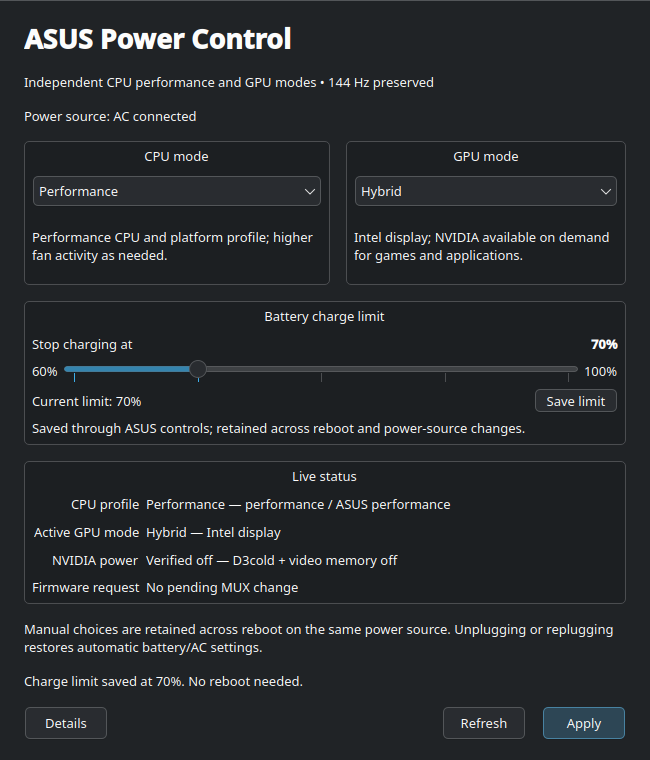

# ASUS Power Control

A small Linux/KDE application with independent **CPU performance** and **GPU
mode** selectors, a **60–100% battery charge-limit slider**, and the boot/AC/battery
policy needed to reinstall the setup.

Press **Ctrl+Alt+S** to toggle the Armoury-style realtime system-monitor OSD.

Built and verified on an **ASUS TUF Dash F15 FX517ZC**, Intel i5-12450H + NVIDIA
RTX 3050 Laptop GPU, running **Fedora 44 KDE Wayland**.



## Modes

| CPU | System profile | ASUS profile |
|---|---|---|
| Silent | Power Saver | Quiet |
| Balanced | Balanced | Balanced |
| Performance | Performance | Performance |

| GPU | Behaviour |
|---|---|
| Integrated | Intel display; NVIDIA access blocked so the GPU and VRAM can power down |
| Hybrid | Intel display; NVIDIA available to applications on demand |
| Ultimate (Dedicated) | NVIDIA drives the internal display directly through the hardware MUX |

The choices are independent. **Balanced + Integrated**, **Silent + Hybrid**,
and **Performance + Ultimate** are all supported. Ultimate requires AC.
Entering or leaving Ultimate requires an orderly reboot; the GUI shows active
and pending modes separately. Integrated ↔ Hybrid normally needs no reboot.

- Manual choices persist across reboot on the same power source.
- Unplugging restores **Silent + Integrated**; replugging restores
  **Performance + Hybrid**. AC never automatically requests Ultimate.
- GPU shutdown is verified using **D3cold + Video Memory Off**.
- The application preserves the selected display refresh rate. The verified
  machine uses **1920×1080 at 144 Hz** in every mode.

## Battery charge limit

Move the slider to a limit between **60% and 100%**, in 1% steps, then click
**Save limit**. The panel shows both your selected value and the current applied
limit. ASUS saves the limit persistently, including across reboot and AC/battery
changes. Saving the charge limit is independent of the CPU/GPU Apply button and
does not require a reboot.

The slider initializes from the actual ASUS limit. Loading the app or moving
the slider does not change charging until you save. Lowering the cap stops
further charging; it does not discharge a battery already above that value.

## System monitor OSD

Press **Ctrl+Alt+S** to show or hide a subtle top-left overlay. It updates once per
second and reports CPU temperature/usage, RAM usage, CPU power when the kernel
exposes unprivileged RAPL energy data, GPU temperature/usage, VRAM usage, GPU
power draw, optional GPU voltage, and FPS.

The RTX telemetry path uses Cardwire first. If the GPU is blocked or in D3cold,
the OSD does not run `nvidia-smi`; it reports the dGPU as blocked/off instead of
waking it. When Hybrid or Ultimate makes NVIDIA available, querying live NVIDIA
telemetry can keep the dGPU awake while the OSD is visible.

NVIDIA's Linux driver does not expose a reliable system-wide game FPS value to a
separate Wayland application. FPS therefore displays `N/A` unless an external
game overlay supplies a numeric file through `ASUS_POWER_CONTROL_FPS_FILE`.
The OSD does not confuse the 144 Hz display refresh rate with game FPS. Voltage
is shown when `nvidia-settings` exposes it and otherwise displays `N/A`.

## Reinstall after reinstalling Linux

### 1. Install the underlying system tools

Start with a working Fedora KDE Wayland installation and NVIDIA driver. Follow
[the Fedora reinstall guide](docs/reinstall-fedora.md) for Terra, NVIDIA/Secure
Boot, package replacements, and the required services.

Required packages:

```bash
sudo dnf install --setopt=install_weak_deps=False asusctl cardwire power-profiles-daemon python3-pyside6 python3-psutil \
    polkit upower desktop-file-utils
```

On a fresh Fedora installation, replace `tuned-ppd` with PPD and
`switcheroo-control` with Cardwire as described in the guide before this command.

### 2. Clone and install this project

Clone the repository and run these commands as your normal desktop user:

```bash
git clone https://github.com/IRONMAN2607/asus-power-control.git
cd asus-power-control
python3 install.py --dry-run
python3 install.py
```

The installer requests `sudo` for the system helper/configuration. It installs
the GUI for the current user, patches the existing ASUS/Cardwire configuration,
clears KDE's saved automatic profile overrides, and enables the boot policy.
It retains backups of changed files and their original service enablement.

**Save your work and reboot normally after installation** so the updated daemon,
logind, and boot configuration is loaded. Then launch:

```bash
asus-power-control
```

Or search **ASUS Power Control** in KDE's application launcher. If your shell
does not yet include `~/.local/bin`, use `~/.local/bin/asus-power-control`.

For the original battery display settings (32% brightness, dim after two
minutes, screen off after five minutes):

```bash
python3 install.py --battery-display-settings
```

Set the panel to **144 Hz** once in KDE Display Configuration after a fresh OS
install. The CPU/GPU commands do not change it. The installer preserves charging
limits; use the GUI slider to save your preferred limit afterward.

## What is included

```text
asus_power_control.py       Unprivileged Qt 6 GUI
monitoring.py               Read-only CPU/RAM/GPU telemetry collector
osd.py                      Armoury-style transparent telemetry OSD
backend/asus-power-mode     Privileged policy/status helper
install.py                  Installer, dry run, and backup restoration
packaging/                  Desktop entry, launcher, and system configuration
docs/                       Reinstall, usage, architecture, verification
tests/                      Simulated policy/UI and installer tests
.github/workflows/tests.yml Headless CI
```

The backend deliberately targets this machine's AC source `ACAD`, GPU PCI
address `0000:01:00.0`, and firmware MUX values. The installer checks the FX517ZC
model, Fedora, Wayland, BPF LSM, and the ASUS firmware D-Bus controls. Other
models/distributions need adaptation rather than copying these hardware values.

## CLI

```bash
asus-power-mode status
asus-power-mode status-json
asus-power-mode charge-limit 80
asus-power-mode custom balanced integrated
asus-power-mode custom performance hybrid
asus-power-mode custom performance ultimate
asus-gaming-mode
asus-battery-mode
asus-power-mode normal
```

## Tests

```bash
QT_QPA_PLATFORM=offscreen python3 -m unittest discover -s tests -v
```

For development/CI, install `requirements.txt` in a virtual environment. The
Fedora desktop installation uses its native `python3-pyside6` package.

Read-only live GUI check on the configured laptop:

```bash
python3 tests/smoke_gui.py
```

## Recovery and updates

To restore files and service enablement captured by the installer:

```bash
python3 install.py --uninstall
```

Save your work and reboot afterward. Package swaps and NVIDIA installation are
managed separately by DNF; see [recovery details](docs/reinstall-fedora.md#recovery).

To update, pull the repository and rerun `python3 install.py`. The installer
retains the first pre-install backups rather than replacing them on each update.

## Documentation

- [Reinstall Fedora from scratch](docs/reinstall-fedora.md)
- [Using the GUI and CLI](docs/usage.md)
- [Architecture and configuration ownership](docs/architecture.md)
- [Hardware verification record](docs/verification.md)
- [OSD telemetry notes](docs/architecture.md#system-monitor-osd)

This project integrates upstream [asusctl](https://github.com/OpenGamingCollective/asusctl),
[Cardwire](https://github.com/OpenGamingCollective/cardwire),
[Power Profiles Daemon](https://gitlab.freedesktop.org/upower/power-profiles-daemon),
and NVIDIA runtime power management. Those components and drivers are installed
from their respective repositories; their source is not vendored here.
